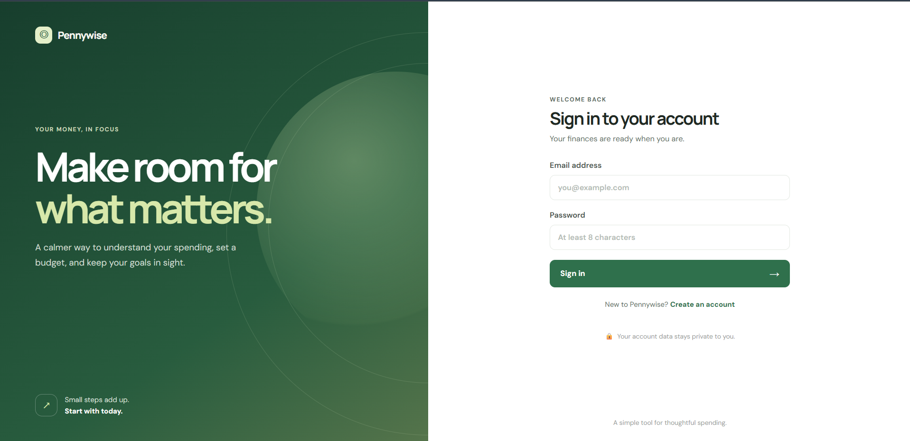
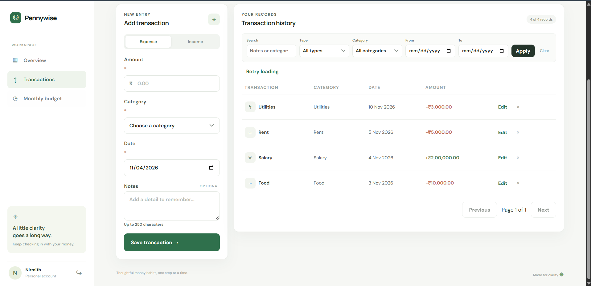
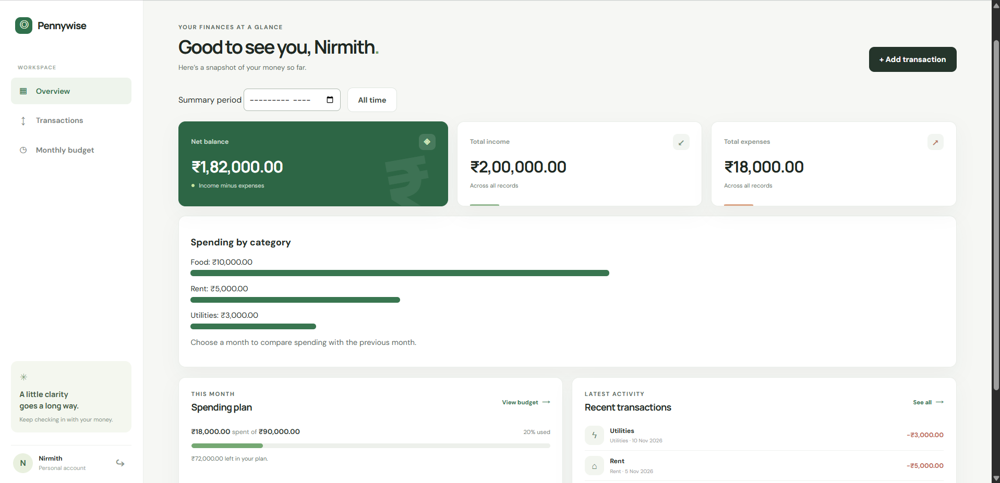
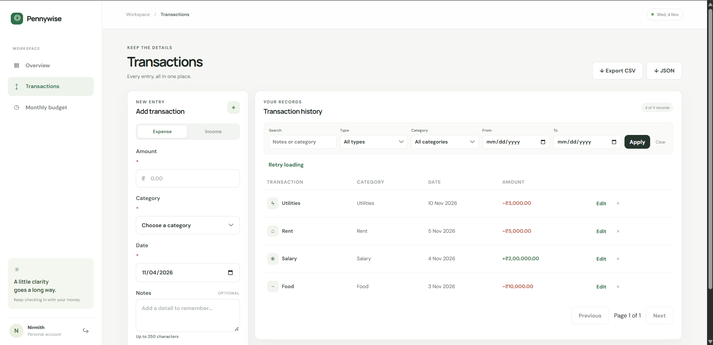
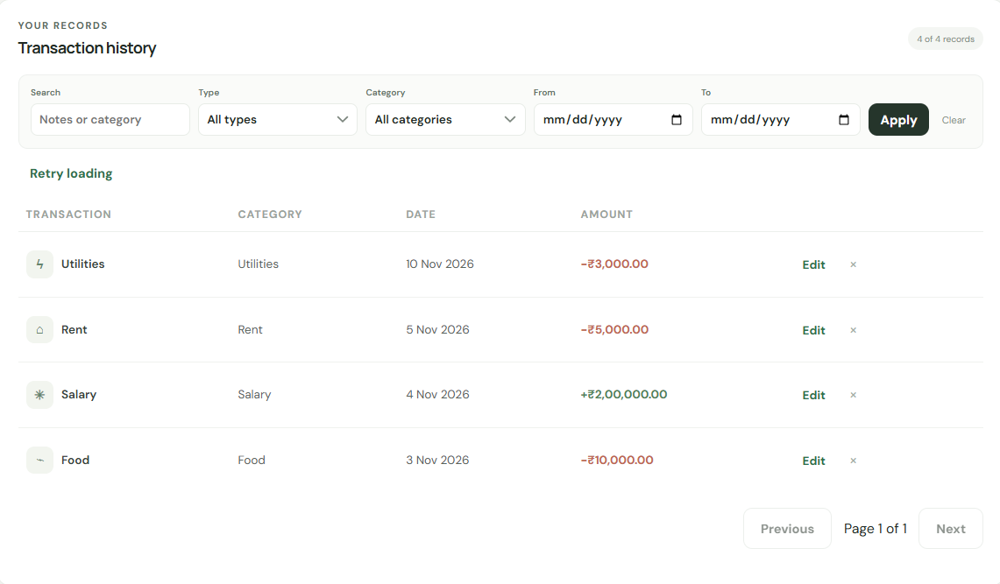
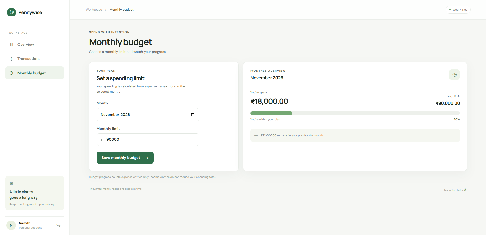
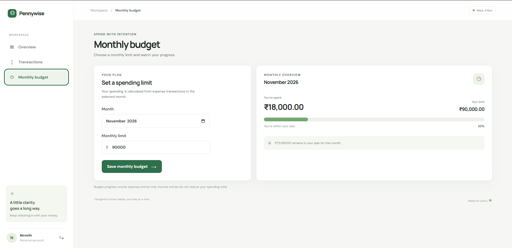

# Pennywise – Personal Finance & Expense Tracker

A full-stack personal finance management application built using **HTML, CSS, JavaScript, Node.js and Express.js**. Pennywise helps users manage their income, track expenses, monitor monthly budgets, and understand their spending habits through a clean and responsive interface.

## Screenshots

### 1. Landing Page


### 2. User Authentication


### 3. Dashboard
View total balance, income, expenses, spending categories and recent transactions.



### 4. Transaction Management
Add income and expense transactions with categories, dates and notes.



### 5. Transaction History
Search, filter, edit and manage previously recorded transactions.



### 6. Monthly Budget Management
Set monthly spending limits and monitor expenses against the selected budget.



### 7. Budget Overview


---

## Features

- **User Authentication:** Registration, login and logout with password hashing and persistent sessions.
- **Dashboard:** Overview of income, expenses, balance and spending insights.
- **Transaction Management:** Add, edit and delete income and expense records.
- **Transaction History:** Search and filter transactions by category, type and date.
- **Monthly Budget:** Set monthly spending limits and track expenses.
- **Spending Insights:** Category-wise spending breakdown and monthly comparisons.
- **Data Export:** Export transaction history in CSV and JSON formats.
- **Data Persistence:** Store user accounts, transactions and sessions using JSON files.
- **Responsive UI:** Interface designed for desktop, tablet and mobile screens.

## Tech Stack

| Category | Technologies |
|---|---|
| Frontend | HTML5, CSS3, JavaScript |
| Backend | Node.js, Express.js |
| Data Storage | JSON File System |
| Authentication | bcryptjs, express-session |
| Security | Helmet, express-rate-limit |
| Testing | Node.js Test Runner |

## Project Structure

```text
personal-finance-tracker/
│
├── data/
│   └── .gitkeep
│
├── public/
│   ├── app.js
│   ├── index.html
│   └── styles.css
│
├── screenshots/
│   ├── 1.png
│   ├── 2.png
│   ├── 3.png
│   ├── 4.png
│   ├── 5.png
│   ├── 6.png
│   └── 7.png
│
├── tests/
│   └── regression.test.js
│
├── .env.example
├── .gitignore
├── package.json
├── package-lock.json
├── server.js
├── storage.js
├── README.md
└── TESTING.md
```

## Installation and Setup

### Prerequisites

- Node.js 22 or newer
- npm

### 1. Clone the repository

```bash
git clone https://github.com/NirmithM06/Pennywise-Personal-Finance-Tracker.git
```

### 2. Navigate to the project directory

```bash
cd Pennywise-Personal-Finance-Tracker
```

### 3. Install dependencies

```bash
npm ci
```

### 4. Configure environment variables

Create a `.env` file by copying `.env.example`.

For Windows PowerShell:

```powershell
Copy-Item .env.example .env
```

Generate a secure session secret:

```bash
node -e "console.log(require('node:crypto').randomBytes(32).toString('hex'))"
```

Copy the generated value into `.env` as `SESSION_SECRET`.

### 5. Start the application

```bash
npm start
```

Open the application in your browser:

```text
http://localhost:3000
```

## Testing

Run the automated regression tests using:

```bash
npm test
```

The test suite covers:

- Authentication and session handling
- Transaction validation and persistence
- User data isolation
- Concurrent transaction updates
- Transaction editing
- Budget calculations
- CSV and JSON exports
- Data recovery and error handling

**Test Result:** All regression tests passed.

## Security and Reliability

- Passwords are stored as bcrypt hashes.
- Session cookies use HTTP-only and SameSite protections.
- Authentication endpoints have rate limiting.
- API requests include validation and ownership checks.
- File updates use serialized operations and atomic writes.
- Runtime data and environment secrets are excluded from version control.

## Future Improvements

- Interactive spending analytics and visual reports.
- Additional financial insights and savings recommendations.
- Database migration to SQLite or PostgreSQL.
- Cloud deployment and persistent hosted storage.

---

## Author

**Nirmith Sai Manda**

B.Tech – Information Technology  
Manipal Institute of Technology, Manipal

GitHub: [@NirmithM06](https://github.com/NirmithM06)

---

⭐ If you find this project interesting, consider giving the repository a star!